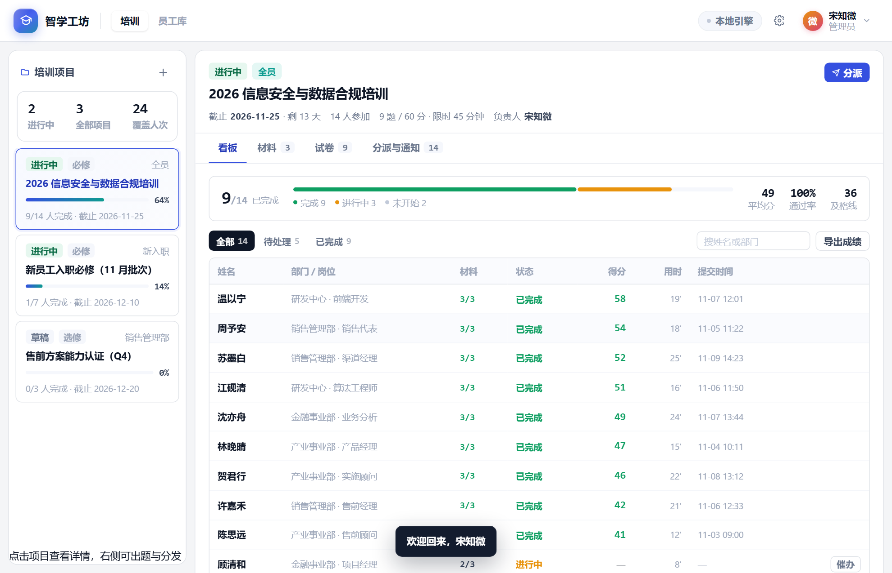
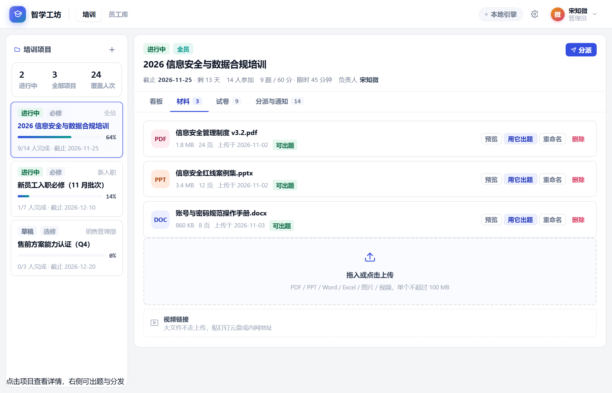
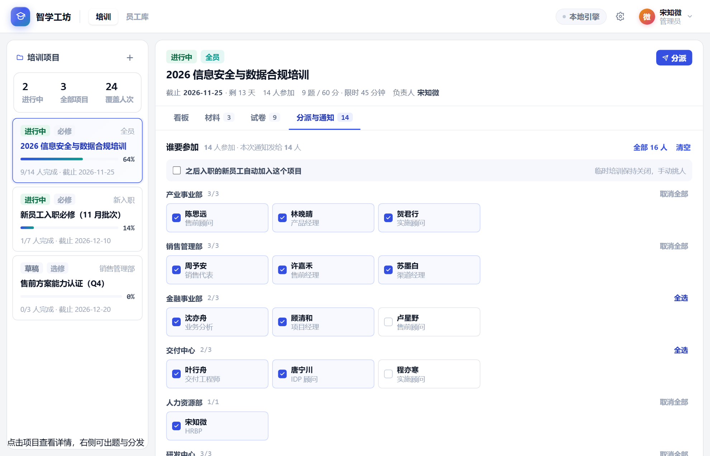
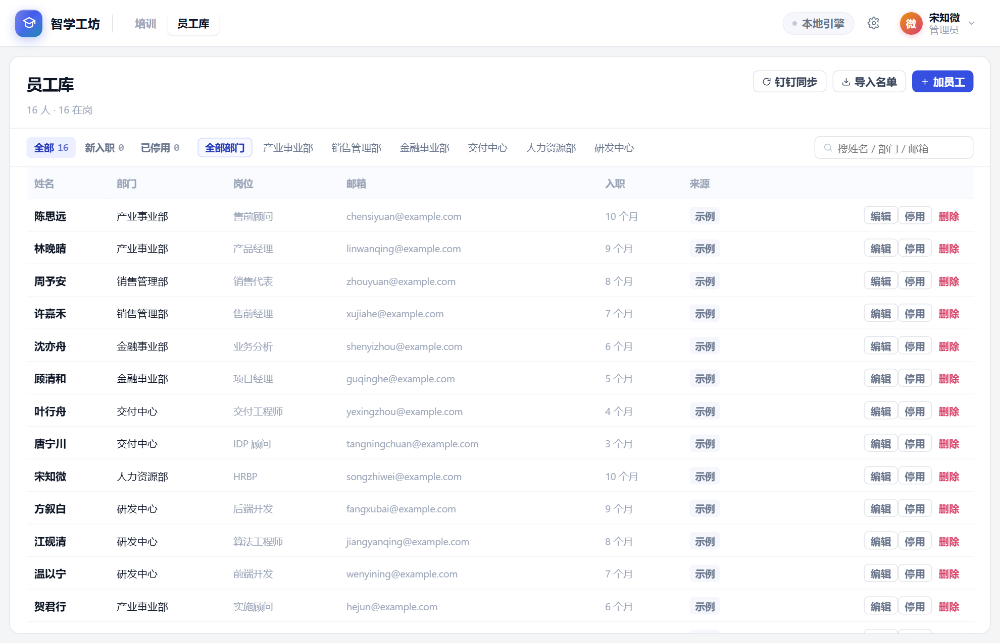
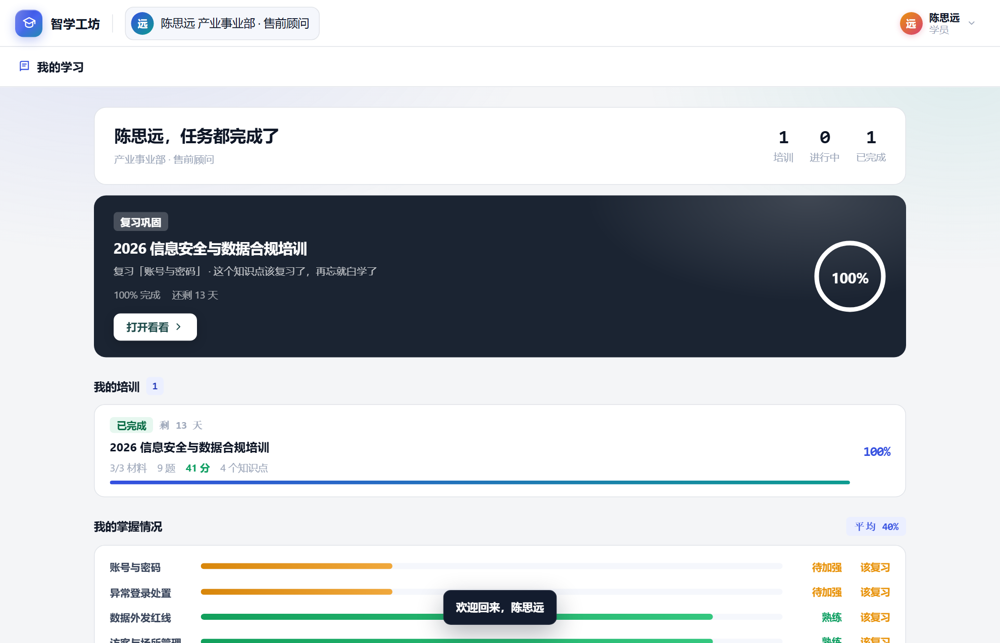
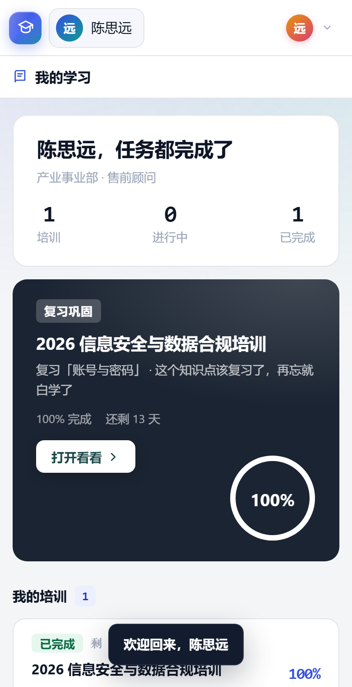

# 智学工坊

**给中小团队用的培训与考核系统。** 上传材料 → 配置试卷 → 分派给人 → 看谁学完了、谁没学完。

纯前端，不需要服务器、不需要数据库、不需要装环境。下载下来双击 `index.html` 就能用。

[在线演示](https://zhixue-workshop.app.workbuddy.host/?sharecode=73MUE3UHCF) · [5 分钟上手](#快速开始) · [MIT 许可证](LICENSE)



---

## 为什么做这个

公司要做新员工入职培训，摆在面前的选择只有两个：买一套 LMS（动辄几万一年，功能九成用不上），或者用网盘发材料 + Excel 收成绩（不知道谁真读了，也不知道谁真会了）。

于是写了这个。它只解决三件事，但每件都做到底：

- **材料要真被读到** —— 在线阅读器内嵌 PDF、PPT、Word、Excel，逐份标记已读，进度可查
- **考试要真能反映会不会** —— 按知识点标注题目，用贝叶斯知识追踪算掌握度，而不是拿「答对几题 ÷ 总题数」糊弄
- **数据要能交差** —— 一键导出 CSV，包含没开始的人、工号、及格线、是否通过，直接进 Excel 报表

数据全部存在浏览器本地（`localStorage` + `IndexedDB`），文件不上传到任何服务器。适合一个人维护、几十人使用的场景。

---

## 能做什么

| | |
|---|---|
| **材料在线阅读** | PDF 内嵌翻页，PPT / Word / Excel 提取正文重排版，图片、txt、视频直接看 |
| **视频双通道** | 小文件存本地，大文件贴外链（钉钉云盘、对象存储都行），不占浏览器空间 |
| **配置试卷** | 五种题型、逐题编辑、按知识点标注；可以让 AI 从材料里出题，也有纯本地引擎兜底 |
| **分派与通知** | 按部门分组选人、五套通知模板、17 个变量；新入职员工可自动加入固定培训 |
| **掌握度诊断** | BKT 贝叶斯追踪 + FSRS 间隔复习，告诉你哪个知识点该复习，不说假精确 |
| **成绩看板** | 完成率、分数分布、逐题正确率、最常答错的题；可搜索、可筛选、可导出 |
| **员工库统一** | 一份人员名单驱动全站：手工添加、CSV 导入、钉钉通讯录同步 |

---

## 快速开始

```bash
git clone https://github.com/origin-july/zhixue-workshop.git
cd zhixue-workshop
```

**直接双击 `index.html`** —— 就这样，没有第 3 步。

想用本地服务器打开（推荐，`IndexedDB` 在 `file://` 下个别浏览器会有限制）：

```bash
python3 -m http.server 8080
# 浏览器打开 http://localhost:8080
```

### 登录

| 角色 | 账号 | 密码 |
|---|---|---|
| 管理员 | `admin` | `admin2026` |
| 学员 | `chensiyuan` | `train2026` |

16 位种子员工各有一个学员账号，用户名是邮箱前缀，密码统一 `train2026`。登录后可在「头像 → 账号管理」里改密码、加账号。

> **别给 `index.html` 改名。** 页面靠同目录的 `assets/`、`lib/` 加载，改名后所有相对路径都会断。想用中文名入口，打开同目录的 `培训初模.html`，它自动跳到 `index.html`。

---

## 界面

### 管理端

一行摘要（已完成 9/14 + 分段进度带 + 平均分 / 通过率 / 及格线），下面一张表就是全部人。顶部可按 **全部 / 待处理 / 已完成 / 未通过** 切，可搜姓名部门，末尾导成绩。



一页做完分派：选人（按部门分组，可一键选「新入职」）→ 改通知内容 → 发出去。



所有「人」的唯一来源，培训分派、学员登录、成绩统计都读这一份。



### 学员端



手机上表格自动变成卡片：姓名 + 得分一行，材料进度、状态、交卷时间一行。



---

## 掌握度是怎么算的

不是「答对几题除以总题数」，是**贝叶斯知识追踪（BKT）+ 间隔重复（FSRS）**。

### 为什么选这两个

| 算法 | 数据门槛 | 可解释 | 建模遗忘 | 本场景 |
|---|---|---|---|---|
| **BKT**（1995） | 几十条作答 | 强 | 需扩展 | ✅ 采用 |
| PFA（2009） | 几百条 | 中 | 需加衰减 | — |
| IRT / CAT | 每题需几百份校准 | 中高 | 否 | ❌ 要预校准 |
| 知识空间 KST | 需专家建领域模型 | 强 | 否 | ❌ 建模成本太高 |
| DKT（2015） | 5 万+ 序列 | 弱（黑盒） | 隐式 | ❌ 训练不起 |
| AKT（2020） | 同上 | 弱 | 隐式 | ❌ 同上 |
| **FSRS / SM-2** | 个人自身序列 | 强 | 是 | ✅ 采用 |

几十到几百人的企业培训，没有历史作答数据，做不了 IRT 校准，更训练不了深度模型。BKT 只需四个经验参数就能工作，且每个数字都能向员工解释。FSRS 补上 BKT 的短板 —— BKT 只知道「当时学会了」，不知道「现在还记不记得」。

### 两个数各管一件事

| 量 | 怎么算 | 干什么用 |
|---|---|---|
| **学会程度 p** | BKT 四参数贝叶斯更新 | 决定等级：熟练 / 一般 / 待加强 / 未掌握 |
| **保持率** | `0.9 ^ (距上次作答天数 ÷ 稳定性S)` | 决定要不要标「该复习」 |
| 综合分 | `p × 保持率` | 内部排序、弱项筛选 |

**等级只看 p，不看保持率。** 学会了就是学会了，忘掉只是「该复习」，不该把等级拉下来 —— 否则员工会发现「明明全对，过两天变待加强」，失去信任。

### 参数

```
P_INIT    = 0.2    没做过题时假定 20% 已经会了
P_GUESS   = 0.2    不会但猜对（选择题有 25% 底噪）
P_SLIP    = 0.15   会了但答错。教科书取 0.1，培训场景调高：
                   员工看错题、点错选项比闭卷考试常见，一次答错不该判「不会」
P_TRANSIT = 0.15   每做一次题，从不会变成会的概率
```

FSRS 侧：稳定性初值 1 天，答错减半，答对按档位 ×1.2 / ×2.0 / ×3.0，难度在 1~10 之间调节涨幅。

### 三条约束

1. **证据不够就不给数。** 同一知识点答满 2 次才出等级，否则显示「数据不足」。一次考试 9 题分 5 个知识点、每块不到 2 题的情况，如实说「没证据」，不编一个百分比。
2. **只追加，不改写。** 每次作答写成一条事件，存 `record.events`。掌握度从事件重算，算法改了直接重跑，不用迁数据。
3. **答错惩罚重于答对奖励。** 答错时稳定性直接减半、难度 +1；答对只按档位涨。代价不对称 —— 多复习一次的代价，比「真忘了却没安排复习」小。

一个诚实的说明：参数是教科书起步值，没在真实数据上标定过。**同一门课内横向比较有意义**（都用同一套参数），当绝对值读没有依据。所以界面上显示「熟练 / 一般 / 待加强」这种定性等级，不显示「0.8763」这种假精确。

---

## 三个模块

### 培训管理

左栏项目列表，中栏四个页面：**看板 / 材料 / 试卷 / 分派与通知**。右栏出题助手只在「试卷」页出现，其余页面中栏铺满。

管理端只回答两个问题：**现在什么情况**、**我该做什么**。没有「以某人的身份查看」这类调试入口 —— 那是开发者的工具，不该出现在 HR 每天用的界面里。

**看板** 一行摘要 + 一张覆盖全部人的表：姓名、部门岗位、材料读了几份、状态、得分（不及格的标出差几分）、用时、提交时间。有成绩后在下面出分数分布和最常答错的题。

**材料** 上传 PDF / PPT / Word / Excel / 图片 / txt / 视频，单份不超过 100 MB；大视频走外链。每份材料带「用它出题」，跳到试卷页并预选。

**试卷** 逐题展开改题干、选项、答案、难度、分值；右侧出题助手选材料生成新题。

**分派与通知** 一页做完三件事：选人 → 改通知内容（五套模板、17 个变量，预览折叠着不占地方）→ 发出去。下面就是发送记录。看板的「催办」直接跳到这里，自动切催办模板、只勾那个人。

未分派的项目，看板显示三步准备清单（传材料 → 出题 → 选人），每步带按钮跳过去。

### 我的学习

三层结构，从「现在该干什么」一路到「我哪里不会」。

**学习台** 顶部问候 + 三个数字（培训数 / 进行中 / 已完成）；**继续学习大卡**直接告诉你下一步做什么，点进去就落在该看的那一节；下面是培训列表和跨培训的**掌握情况**汇总。

**培训学习页** 左侧小节导航（做完打勾、当前高亮、进度实时算），右侧内嵌阅读器，不再弹全屏遮罩：

| 类型 | 打开方式 |
|---|---|
| PDF | 浏览器原生阅读器内嵌，可翻页缩放 |
| 图片 | 直接显示 |
| PPT / PPTX | 解包读 `ppt/slides/slideN.xml`，按页提取文字排版 |
| Word / DOCX | 读 `word/document.xml`，段落还原 |
| Excel / XLSX | 读 sharedStrings + 各 sheet，按行还原 |
| txt / md / csv | 直接渲染，自动识别 GBK 与 UTF-8 |

**考核** 入口卡先告诉你题量、满分、及格线、限时、上次分数。开考后顶部倒计时（剩 5 分钟变黄、1 分钟变红闪、到点自动交卷），**交卷按钮常驻右上角**；题号导航条已答绿、待定黄、当前蓝框；底部**上一题居左、下一题居右**，中间是已答进度和「标记待定」。

**成绩** 大步分数 + 通过与否 + 答对数 / 用时 / 及格线 / 得分率，然后三块：知识点掌握情况、建议下一步复习什么、逐题回顾（你的答案 vs 正确答案 + 解析）。

### 员工库

所有「人」都在这里，培训分派、学员登录、成绩统计都读这一份，不再各存一份名单。

| 来源 | 怎么进来 |
|---|---|
| 示例 | 首次运行时的 16 位种子员工 |
| 手工 | 右上角「加员工」，填姓名 / 部门 / 岗位 / 邮箱 / 工号 / 入职日期 |
| 导入 | 「导入名单」选 CSV，或直接把 Excel 表格粘进来。按姓名 + 邮箱判重，已有的更新、没有的新增，先看预览再确认 |
| 钉钉 | 「钉钉同步」。见下 |

**入职日期决定两件事**：入职 30 天内标「新入职」，顶部「新入职」筛选一拉就出来；培训项目上打开「之后入职的新员工自动加入」，之后同步进来的人会自动进该项目，不用再手工挑。

固定入职培训就开这个开关；临时培训保持关闭，每次手动选人。

#### 接钉钉

浏览器直连钉钉会同时踩两个坑：CORS 挡请求，AppSecret 暴露在前端。所以正式做法是加一层自己的后端：

1. 钉钉开放平台建**企业内部应用**，开通「通讯录部门信息读权限」「成员信息读权限」
2. 后端用 AppKey / AppSecret 换 access_token，拉 `/topapi/v2/user/list`，把 `name / dept / title / email / hiredate` 整成数组
3. 前端只读结果：现在可以把这段 JSON 直接贴进「钉钉同步」弹窗验证，字段对上就直接入库，来源自动标「钉钉」

`staff.js` 里的 `ingest(rows)` 是入口，接好后端后把 `S.ding.endpoint` 填上就能一键拉取。

---

## 材料与视频

支持 PDF / PPT / Word / Excel / 图片 / txt / mp4 / webm，单份不超过 100 MB，存 `IndexedDB`。

视频还有一条**外链**通道：材料页点「视频链接」，贴一个 MP4 / WebM 直链。大文件不进浏览器存储，学员端直接在页面里播放。

从材料能提取出文字的，可以拿去出题；纯图片和视频只能看。

---

## 导出

看板右上角「导出成绩」出 CSV，按分派名单走 —— **没开始的人也在里面**，字段：

`姓名 / 部门 / 岗位 / 邮箱 / 工号 / 已读材料 / 材料总数 / 状态 / 得分 / 满分 / 及格线 / 是否通过 / 用时 / 提交时间`

导完直接进 Excel 交差。

---

## 配置 AI 出题

右上角齿轮 → 打开「使用大模型出题」：

| 服务 | 接口地址 | 模型名 |
|---|---|---|
| DeepSeek | `https://api.deepseek.com/v1` | `deepseek-chat` |
| Kimi | `https://api.moonshot.cn/v1` | `moonshot-v1-32k` |
| 自建中转 | 你的 OpenAI 兼容地址 | 按你的服务填 |

有「测试连接」。不填也能用，退回本地引擎 —— 结构对，语言偏机械。

---

## 文件结构

```
index.html               入口 + 登录页 + 三模块骨架（唯一入口，勿改名）
培训初模.html            别名入口，自动跳转到 index.html
assets/style.css         样式（单文件，无预处理器）
assets/train-data.js     种子数据（16 人、3 个培训、材料正文、带知识点标注的试题、作答事件）
assets/core.js           常量、状态、本地存储
assets/auth.js           账号与会话
assets/files.js          文件库：IndexedDB 存取、类型识别、Office 文字提取
assets/learning.js       学习引擎：BKT 掌握度 + FSRS 复习调度 + 错题状态机
assets/reader.js         独立阅读器（管理端预览材料用，含视频）
assets/engine.js         文本解析、本地出题、大模型调用
assets/exporter.js       xlsx / json / markdown 导出
assets/staff.js          员工库（增删改 / CSV 导入 / 钉钉落地 / 新员工自动加入）
assets/student.js        我的学习（学习台 / 学习页 / 考试 / 成绩）
assets/train.js          培训管理
assets/ui.js             登录、角色路由、模块切换、账号管理、设置
lib/                     SheetJS、JSZip
tests/                   自动化测试
docs/screenshots/        README 用截图
```

**架构取向**：没有构建步骤，没有打包器，没有框架。全部是 ES5 的 IIFE，模块挂在 `window` 上，靠 `<script>` 顺序加载。听起来原始，但换来三件事：双击就能跑、改完刷新就生效、三年后回来还能读懂。

两套存储：`localStorage` 存培训结构与作答事件，`IndexedDB` 存文件本体。

---

## 测试

```bash
npm install

npm run test:learning  # BKT / FSRS 数值与边界                28 项
npm run test:auth      # 登录 / 角色 / 账号 / 员工库           53 项
npm run test:train     # 培训管理四页全流程                   68 项
npm run test:staff     # 员工库：加人 / 导入 / 钉钉 / 自动加入    27 项
npm run test:material  # 材料上传与在线阅读                   31 项
npm run test:learn     # 我的学习全流程                       44 项
npm run test:layout    # 布局与字号（12 个视图 × 5 档宽度）
npm run test:mobile    # iPhone 390 / 平板 768                22 项
npm run test:quality   # 出题结构校验
npm run test:ai        # mock 接口验证 AI 出题链路
npm run visual         # 关键元素计算样式核对
```

测试用 Playwright 真开浏览器跑，不是 jsdom 模拟。`tests/make-fixtures.js` 会生成真实的 PDF / PPTX / DOCX 供上传测试用。

跑全部：

```bash
npm run test:all
```

**红线**：最小字号 13px；不显示假精确的百分比；手机端不允许横向滚动。这三条有测试守着。

---

## 路线图

- [ ] 账号与成绩换成后端存储，支持多人协作（当前是单机本地存储）
- [ ] 真正的邮件发送（现在只导出 `.eml`）
- [ ] 题库复用：一个知识点跨培训共享
- [ ] 导出列映射自定义

有想做的功能，开 Issue 聊。

---

## 参与

欢迎一切形式的贡献 —— 提需求、报 bug、改文案、加测试、写文档，都算。

```bash
git checkout -b feat/你的功能名
# 改完确认测试还是绿的
npm run test:all
git commit -m "feat(scope): 一句话说清改了什么"
git push origin feat/你的功能名
```

提交信息用 Conventional Commits：`feat` 新功能、`fix` 修 bug、`docs` 文档、`refactor` 重构、`test` 测试、`chore` 杂项。

几条约定：

- **先跑测试再提 PR。** 红了就先修，别指望别人替你兜
- **改数据的改动要说明兼容性** —— 存储结构变了，老用户的存档还能不能读
- **界面改动附截图**，方便一眼看出改了什么
- **不要引入构建步骤。** 这是有意为之的约束，不是疏漏

详细约定见 [CONTRIBUTING.md](CONTRIBUTING.md)。

---

## 安全说明

**当前是单机版本，请按单机版本使用。**

账号密码明文存在浏览器 `localStorage` 里，方便管理员查看和转发。这在本机个人使用场景下是合理取舍，**但不要直接放到公网服务器给全员用**。

要上服务器，至少需要：后端鉴权 + 密码哈希（bcrypt / argon2）+ 真正的邮件发送 + HTTPS。掌握度算法本身是纯函数，可以原样搬到服务端。

---

## 许可证

[MIT](LICENSE)。随便用，随便改，出问题别找我。
